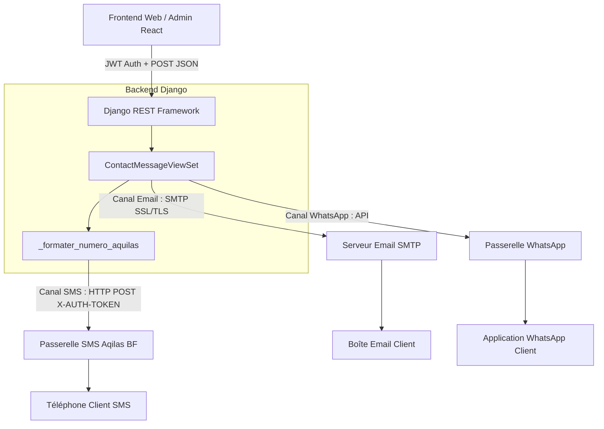

# Guide Technique : Intégration des Canaux de Communication (SMS, Email, WhatsApp)

Ce document détaille l'architecture des services de communication de l'application **Étude Notariale**, leur configuration, les flux de requêtes, ainsi que le catalogue complet des erreurs possibles et leurs résolutions.

---

## 1. Vue d'Ensemble de l'Architecture

L'application intègre trois canaux de communication pour répondre aux contacts et notifier les usagers :



---

## 2. Canal SMS – API Aqilas (Burkina Faso)

### A. Fonctionnement & Format Officiel (v1)

Le service utilise la passerelle **Aqilas**, spécialisée dans l'envoi de SMS en Afrique de l'Ouest (notamment au Burkina Faso).

- **Route API Django** : `POST /api/contact/<id>/send-sms/`
- **Contrôle d'accès** : Réservé aux administrateurs (`IsAdminOrSuperAdmin`).
- **Endpoint distant Aqilas** : `https://www.aqilas.com/api/v1/sms`
- **Méthode d'authentification** : En-tête HTTP `X-AUTH-TOKEN: <API_KEY>`

### B. Format des Requêtes

#### 1. Ce que le Frontend envoie au Backend Django :
```json
POST /api/contact/42/send-sms/
Authorization: Bearer <TOKEN_JWT>
Content-Type: application/json

{
  "message": "Bonjour, votre dossier a été validé par Maître DEMBELE."
}
```

#### 2. Ce que le Backend Django transmet à Aqilas :
```http
POST /api/v1/sms HTTP/1.1
Host: www.aqilas.com
X-AUTH-TOKEN: <AQILAS_API_TOKEN>
Content-Type: application/json
Accept: application/json

{
  "from": "DGONTB",
  "to": ["+22653169736"],
  "text": "Bonjour, votre dossier a été validé par Maître DEMBELE."
}
```

### C. Normalisation automatique des numéros (`_formater_numero_aquilas`)
Le backend applique une sanitisation stricte sur le numéro de téléphone du contact avant l'envoi :
1. Suppression de tous les caractères non numériques (espaces, tirets, points, parenthèses).
2. Suppression du préfixe international `00`.
3. Si le numéro fait **8 chiffres** (format local Burkinabè, ex: `53169736`), le préfixe pays **`+226`** est automatiquement ajouté (`+22653169736`).
4. Si le numéro commence déjà par `226`, le `+` est garanti.

---

## 3. Canal Email – SMTP

- **Route API Django** : `POST /api/contact/<id>/send-email/`
- **Fonctionnement** : Utilise `django.core.mail.send_mail` branché sur le serveur SMTP configuré dans `settings.py`.
- **Payload attendu** :
  ```json
  {
    "sujet": "Suivi de votre demande",
    "message": "Madame, Monsieur, nous avons bien pris en compte votre demande..."
  }
  ```

---

## 4. Canal WhatsApp

- **Route API Django** : `POST /api/contact/<id>/send-whatsapp/`
- **Contexte** : 
  - Historiquement préparé pour **Twilio** (`TWILIO_ACCOUNT_SID`, `TWILIO_AUTH_TOKEN`, `TWILIO_WHATSAPP_NUMBER`).
  - **Évolution en cours** : Aqilas propose désormais un canal **WhatsApp (Nouveau)** directement dans son tableau de bord avec gestion des *Numéros connectés* et des *Templates WA*.

---

## 5. Variables d'Environnement Requises

Ces clés doivent être renseignées dans votre fichier `.env` en local ou dans la section **Environment Variables** de votre hébergeur (Render) :

| Variable | Canal | Description | Exemple / Valeur |
| :--- | :--- | :--- | :--- |
| `AQILAS_API_TOKEN` ou `AQUILAS_API_KEY` | **SMS** | Clé secrète / token API de votre compte Aqilas | *(clé secrète)* |
| `AQUILAS_SENDER_ID` | **SMS** | Nom de l'expéditeur approuvé par Aqilas (max 11 caractères) | `DGONTB` |
| `AQUILAS_API_URL` | **SMS** | *(Optionnel)* URL de l'API Aqilas (valeur par défaut automatique) | `https://www.aqilas.com/api/v1/sms` |
| `EMAIL_HOST` | **Email** | Hôte SMTP | `smtp.gmail.com` |
| `EMAIL_HOST_USER` | **Email** | Adresse email d'expédition | `contact@etude-notaire.bf` |
| `EMAIL_HOST_PASSWORD` | **Email** | Mot de passe d'application SMTP | *(mot de passe)* |
| `DEFAULT_FROM_EMAIL` | **Email** | En-tête visible de l'expéditeur | `Étude Maître DEMBELE <noreply@etude.bf>` |
| `TWILIO_ACCOUNT_SID` | **WhatsApp** | Identifiant de compte Twilio *(si Twilio utilisé)* | `ACxxxxxxxxxxxx` |
| `TWILIO_AUTH_TOKEN` | **WhatsApp** | Token secret Twilio *(si Twilio utilisé)* | `xxxxxxxxxxxxxx` |
| `TWILIO_WHATSAPP_NUMBER` | **WhatsApp** | Numéro WhatsApp expéditeur | `+14155238886` |

---

## 6. Catalogue Complet des Erreurs Possibles & Résolutions

### A. Erreurs côté Canal SMS (Aqilas)

| Code HTTP | Message d'erreur retourné | Cause racine | Solution |
| :---: | :--- | :--- | :--- |
| **500** | `Service SMS non configuré. Contactez l'administrateur système.` | Les variables `AQILAS_API_TOKEN` et `AQUILAS_API_KEY` sont vides ou absentes de l'environnement (Render / `.env`). | Ajouter la clé d'API dans les variables d'environnement sur Render puis redéployer. |
| **400** | `Le champ "message" est obligatoire.` | Le payload JSON envoyé par le client ne contient pas de texte ou le champ `message` est vide. | Vérifier que le textarea dans la modale frontend envoie bien `{ "message": "..." }`. |
| **400** | `Aucun numéro de téléphone associé à ce message de contact.` | L'expéditeur a rempli le formulaire de contact sans renseigner son numéro de téléphone. | Vérifier les données du message dans la base de données. |
| **400** | `L'API SMS a rejeté la demande : [Détail]` | Rejet par la passerelle Aqilas :<br>1. **Solde de crédits insuffisant** sur votre compte Aqilas.<br>2. **Sender ID non validé** (ex: `DGONTB` doit être validé chez Aqilas).<br>3. Format de numéro refusé. | 1. Recharger le compte Aqilas en crédits SMS.<br>2. Vérifier que le Sender ID `DGONTB` est actif dans l'espace client Aqilas. |
| **502** | `Erreur lors de la communication avec le service SMS : [exc]` | Échec de connexion réseau entre le serveur Django et `www.aqilas.com` (DNS, coupure réseau). | Vérifier la connectivité sortante du serveur ou l'état de service d'Aqilas. |
| **504** | `Le service SMS n'a pas répondu dans le délai imparti.` | L'API Aqilas a mis plus de 15 secondes à répondre (Timeout). | Réessayer l'envoi quelques instants plus tard. |

---

### B. Erreurs côté Canal WhatsApp

| Code HTTP | Message d'erreur retourné | Cause racine | Solution |
| :---: | :--- | :--- | :--- |
| **500** | `Service WhatsApp non configuré. Contactez l'administrateur système.` | Le serveur a reçu une demande d'envoi WhatsApp mais aucune configuration de passerelle WhatsApp n'est active. | Configurer les variables d'environnement WhatsApp du fournisseur retenu (Twilio ou Aqilas WhatsApp). |
| **400** | `Erreur lors de l'envoi WhatsApp : [Détail]` | 1. La fenêtre de 24h Meta est fermée et le message n'utilise pas un Template approuvé.<br>2. Le numéro destinataire n'a pas WhatsApp. | Utiliser un Template pré-approuvé ou vérifier le numéro. |
| **500** | `La bibliothèque 'twilio' n'est pas installée sur le serveur.` | Tentative d'utilisation de Twilio sans le package python `twilio`. | Exécuter `pip install twilio` et l'ajouter à `requirements.txt`. |

---

### C. Erreurs côté Canal Email

| Code HTTP | Message d'erreur retourné | Cause racine | Solution |
| :---: | :--- | :--- | :--- |
| **400** | `Le champ "sujet" est obligatoire.` ou `Le champ "message" est obligatoire.` | L'un des deux champs est absent du formulaire. | Remplir le sujet et le message dans le formulaire. |
| **400** | `Ce message de contact ne possède pas d'adresse email.` | Le message de contact a été soumis sans email valide. | Répondre au contact par SMS ou WhatsApp. |
| **500** | `Impossible d'envoyer l'email : [exc]` | Identifiants SMTP invalides, port bloqué, ou mot de passe d'application Google révoqué. | Mettre à jour `EMAIL_HOST_PASSWORD` avec un mot de passe d'application valide. |

---

## 7. Cycle de Vie d'une Réponse Administrateur

Quand un administrateur envoie un message via l'un des canaux (SMS, Email ou WhatsApp) avec succès :
1. La passerelle externe valide la réception et retourne un identifiant unique (ex: `bulk_id` pour Aqilas).
2. Le backend Django met à jour le champ du contact :
   ```python
   message_obj.is_replied = True
   message_obj.save(update_fields=['is_replied', 'updated_at'])
   ```
3. Une entrée de log d'audit est créée (`logger.info`) consignant le nom de l'administrateur, l'ID du contact et le destinataire.
4. L'API renvoie un statut `200 OK` permettant à l'interface de fermer la fenêtre modale et d'afficher un badge « Répondu ».
